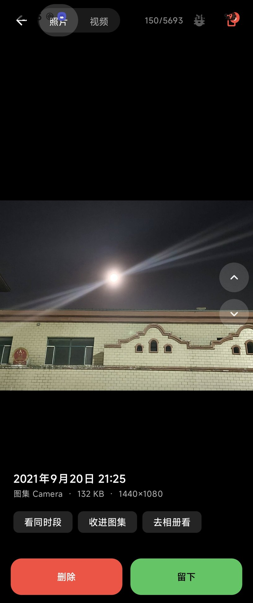
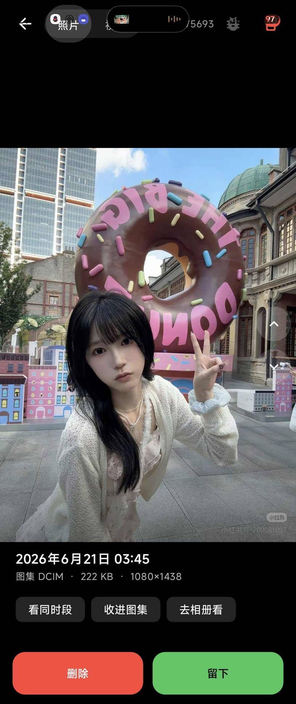

# 刷相册 · SwipeGallery

<p align="center">
  
  
  
  
</p>

把相册变成一条可以"刷"的信息流：上下滑翻页，底部两个按钮决定 **删除** 还是 **留下**，滑过去就算 **跳过**。

已经处理过的照片不会再出现。适合攒了几千张照片、一直懒得清理的人。

<p align="center">
  
  
</p>

## 功能

- **竖向翻页**浏览，照片和视频分成两个 Tab
- **三种状态**：删除 / 留下 / 跳过，全部记录在本地
- **返回上一张**，已标记删除的可以就地撤销
- **攒批删除**：连续删满 15 张才弹一次系统确认，删掉的进系统回收站，30 天内可恢复
- **同时段面板**：看这张照片前后 ±2 小时 / 同一天 / ±3 天的所有照片，一起判断该不该删
- **收进图集**（需 root）：把照片直接收进小米相册的云图集
- **诊断信息**：一键复制设备环境报告，方便反馈问题

## 有 root 和没 root 的区别

**这个 app 的核心功能完全不需要 root。** root 只影响「收进图集」这一项附加功能。

| 功能 | 没 root | 有 root |
| --- | :---: | :---: |
| 上下滑翻页浏览 | ✅ | ✅ |
| 删除 / 留下 / 跳过 | ✅ | ✅ |
| 攒批删除（进系统回收站） | ✅ | ✅ |
| 返回上一张 / 撤销删除 | ✅ | ✅ |
| 同时段面板 | ✅ | ✅ |
| 照片 / 视频分 Tab | ✅ | ✅ |
| 图集列表 | 只有普通文件夹相册 | 还能列出小米**云图集** |
| 收进图集 | ❌ 点了会提示失败 | ✅ |

原因：云图集成员记录存在 MiGallery 自己的数据库里（`/data/data/com.miui.gallery/databases/gallery.db`），该文件属主是相册应用，其他 uid（包括 adb shell、Shizuku）**连读都读不到**，只有 root 能碰。

> 顺带说明：Shizuku 在这里**不能替代 root**。Shizuku 拿到的是 shell 身份，能执行系统命令，但绕不过文件属主权限。

没 root 时 app 从不调用 `su`，不会请求任何提权。

## 环境要求

| 项目 | 要求 |
| --- | --- |
| Android | 11 及以上（API 30） |
| Root | 仅「收进图集」需要，其余功能不需要 |
| ROM | 「收进图集」只针对小米 HyperOS 相册适配过，其他 ROM 不可用 |

## 安装

到 [Releases](../../releases) 下载 APK 安装。

首次打开会请求相册权限。如果系统只给了「部分照片」，可以在设置里改成「全部允许」。

## 使用

- **上下滑**：翻页
- **底部按钮**：删除 / 留下
- **左上角箭头**：回上一张
- **顶部垃圾篓**：立刻处理待删队列（带角标显示攒了几张）

## 构建

需要 JDK 17 和 Android SDK 35。

```bash
./gradlew assembleDebug
```

> 国内网络：`settings.gradle.kts` 里已经配好阿里云 Maven 镜像；`gradle.properties` 里关掉了 AGP 的远程 SDK 清单检查（否则会卡住）。

## 关于「收进图集」

HyperOS 的云图集，成员记录存在 MiGallery 的私有数据库里——**往文件夹里放文件，相册是不认的**（实测确认）。所以这个功能会：

1. 用 MediaStore 把文件移动到目标图集目录
2. 停掉相册进程，往 `gallery.db` 的 `cloud` 表插入一条本地记录
3. 相册下次启动时把它当新成员收下，并同步到云端

写库之前会自动把数据库三件套备份到 `Android/data/com.swipegallery/files/migbackup/`。

⚠️ 这是 hack，HyperOS 大版本更新后可能失效。介意的话可以完全不用这个功能，其余功能不受影响。

## 隐私

- 没有网络权限，不联网
- 不上传任何数据
- 所有决定存在本地 Room 数据库
- 诊断信息只包含设备型号、权限状态、媒体库数量，不含照片内容

## 已知限制

- 只读 MediaStore：只存在 Google Photos 云端、本地没有缓存的照片看不到
- 删除必须经过系统确认框，只能一批一批来
- 几万张的大相册，首次加载要几秒（会把整张列表读进来再打乱）

## English

SwipeGallery turns your photo library into a swipeable feed: swipe up/down to browse, then tap **Delete** or **Keep**. Decisions are stored locally, and deleted photos go to the system trash. Requires Android 11+.

The "move to album" feature requires root and only works with Xiaomi's HyperOS gallery, because it writes directly into the gallery's private database.

## License

[MIT](LICENSE)
